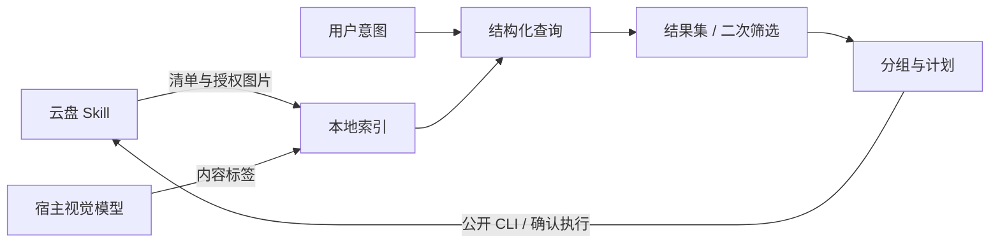

<div align="center">

<h1>Cloud Photo</h1>
<p><strong>先理解照片，再按你的想法整理。</strong></p>
<p>本地内容索引 · 多轮筛选 · 分类相簿<br>面向 OpenClaw / Mclaw，通过中国移动云盘 Skill 访问照片。</p>
<p><a href="SKILL.md">Skill 指南</a> · <a href="references/architecture.md">完整架构</a> · <a href="references/index-runner.md">建立索引</a> · <a href="references/organizing.md">执行整理</a></p>
</div>

---

## 三种入口，同一份结果集

| 你说 | 系统做 |
| :-- | :-- |
| “找去年海边旅行的照片，按月份建相簿。” | 解析条件 → 查内容索引 → 分组 → 云盘计划 |
| “把刚才这些照片按类型整理。” | 读取已有完整结果 → 按标签归类 → 选择目标 |
| “这些里去掉截图，只留清晰的。” | 在原集合内筛选 → 保留子版本 → 继续查看或整理 |

照片内容由宿主视觉模型分批识别，保存在本地 JSONL。自然语言由宿主模型转换为结构化条件，Python 完成集合筛选；不要求云盘提供语义搜索，也不需要向量库。

## 架构



**cloud-photo 管理照片任务，cm-cloud-manage 管理云盘业务。** 两个 Skill 由宿主加载；本项目不直连 OpenClaw 后端，不依赖 Nexus 前端。图片发送和任务卡使用宿主现有能力。

## 已实现与依赖

| 环节 | 本地实现 | 仍需具备 |
| :-- | :-- | :-- |
| 索引 | 分页续接、增量导入、批次与 checkpoint、EXIF、缩略图、原图哈希 | 云盘取图权限、Pillow、宿主视觉模型 |
| 搜索 | all/any/not、字段过滤、未知值、完整结果快照与分页展示 | 模型解释自然语言；实际标签覆盖 |
| 筛选 | 父子结果、显式选图、SHA-256 精确去重、引用刷新 | 人物身份映射、相似/审美精选需额外复核 |
| 整理 | 时间/类型等多维分组，相簿/故事/目录计划，数量与长度分批 | 云盘有效资源引用及目标权限 |
| 执行 | 公开 CLI 适配、冻结计划、确认执行、状态日志、防止重复提交 | 云盘真实写入和宿主媒体端到端验收 |

本地规则引擎不会自行识别人脸或“最好看”的照片。未知标签不会变成确定匹配，搜索成功不代表下载有权限，计划生成也不代表整理已完成。已知权限不足时先解决取图，再建立内容索引。

## 开始使用

1. 将本仓库作为一个 `cloud-photo` Skill 加载，同时加载 [中国移动云盘 Skill](https://skillhub.cn/skills/org-vt43r0t0/cm-cloud-manage)。公开 CLI 适配器面向 2.0.2 的 `scripts/` 布局。
2. 准备 Python >= 3.10；图片处理另需 Pillow。宿主为每个用户/账号分配持久目录和实际可用的视觉模型。
3. 按 [索引流水线](references/index-runner.md) 扫描、取图、生成标签；已有索引可直接查询。

```bash
python3 scripts/cloud_photo.py --help
python3 scripts/index_runner.py --help
python3 scripts/preview_pack.py --help
```

准备 query.json，例如 `{"field":"vision_tags.subjects","op":"eq","value":"猫"}`：

```bash
python3 scripts/cloud_photo.py query \
  --state-dir "$STATE" --owner "$OWNER" \
  --manifest "$STATE/manifest.jsonl" --spec query.json
```

命令返回 result ID，供 refine、select、dedupe 和 group-plan 继续使用。结果不会默认截成 20 张；展示分页与完整成员分开。查询范围已核实取尽时才加 `--complete`。

## 项目结构

```text
cloud-photo/
├── SKILL.md                    Agent 路由与关键规则
├── agents/                     宿主展示元信息
├── scripts/
│   ├── cloud_photo.py          主命令入口
│   ├── index_runner.py         索引命令入口
│   ├── preview_pack.py         静态图片预览
│   └── cloud_photo_core/       存储、索引、查询、分组、计划与云盘适配
└── references/                 按任务读取的协议与流程
```

## 进一步阅读

| 文档 | 内容 |
| :-- | :-- |
| [功能与代码架构](references/architecture.md) | 模块、数据流、状态与外部边界 |
| [查询与结果集](references/index-guidance.md) | QuerySpec、组合条件、未知值与多轮筛选 |
| [标签规范](references/photo-index.md) | 模型输出、事实来源和人物限制 |
| [分组与执行](references/organizing.md) | 相簿、故事、目录、确认和恢复 |
| [云盘公开接口](references/cm-cloud-api.md) | 上游 2.0.2 命令与限制 |
| [宿主接入](references/mclaw-integration.md) | 用户隔离、媒体和运行环境 |
