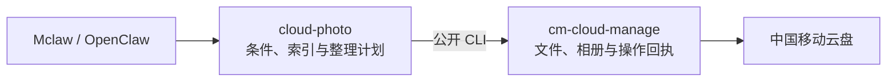

<div align="center">

<h1>Cloud Photo</h1>

<p><strong>找到照片，继续筛选，按你的想法整理。</strong></p>

<p>面向 Mclaw / OpenClaw 的云盘照片 Skill<br>通过中国移动云盘 Skill 访问照片，以本地索引和可追溯计划承接整理需求。</p>

<p>
  <a href="SKILL.md">Skill 指南</a> ·
  <a href="references/cm-cloud-api.md">云盘接口</a> ·
  <a href="references/mclaw-integration.md">接入设计</a>
</p>

</div>

---

## 三种入口，同一条整理流程

| 入口 | 对话示例 | 目标行为 |
| :-- | :-- | :-- |
| **找图整理** | “找去年旅行的照片，按月份建相册。” | 理解条件 → 找图 → 分组 → 成册 |
| **结果整理** | “把刚才这些照片，按类型整理。” | 沿用完整结果集合 → 按规则分组 → 写入目标 |
| **继续筛选** | “这些里去掉截图，只留下清晰的。” | 在当前集合中筛选 → 保留新版本 → 继续查看或整理 |

以上是项目要实现的完整流程。当前仓库已提供索引与候选工具，结果集、组合筛选和自动执行仍需开发，详见下方能力表。

## 如何接入



**云端访问统一经过 `cm-cloud-manage`。** Cloud Photo 负责照片任务的组织逻辑；云盘 Skill 负责鉴权、资源访问、写入计划和执行回执；图片展示使用宿主已有媒体通道。

整理有三种落点：**相册**、**回忆故事**、**云盘文件夹**。相册和故事使用图片引用创建；文件夹整理通过复制写入智能体专属目录，保留原图。

## 当前能力

| 层次 | 已具备 | 边界 |
| :-- | :-- | :-- |
| **本仓库** | JSONL 索引校验与合并、分批处理与 checkpoint、关键词候选、计划草案、静态预览图 | 关键词匹配不等于语义搜索；计划草案不会自动执行 |
| **云盘 Skill 2.0.2** | 文件检索与下载、相册创建与加图、指定图片建故事、建目录与复制、操作状态查询 | 没有公开语义搜图、人物识别、精选去重或结果集内筛选接口 |
| **待补齐的编排** | 已有通用接入设计 | 持久结果集、组合条件、自动分组、引用恢复、批量执行与对账 |

照片的时间、类型和格式可先用现有云盘检索；内容类条件需要已有标签或视觉复核。人物身份、相似精选和大规模语义召回需要额外的已验证能力。

> 云盘接口于 **2026-10-25** 核验：SkillHub 包版本为 **2.0.2**。已检查公开命令、schema 和实现，尚未完成真实账号端到端联调。[查看完整接口与限制 →](references/cm-cloud-api.md)

## 开始使用

1. 将本仓库作为 `cloud-photo` Skill 安装到宿主配置的技能目录，并让目标 Agent 加载它。
2. 同时加载 `@org-vt43r0t0/cm-cloud-manage`，检查实际包版本与公开能力。
3. 准备 Python 环境和按用户隔离的持久工作目录；静态预览另需 Pillow。

在本仓库目录检查本地工具：

```bash
python3 scripts/cloud_photo.py --help
python3 scripts/index_runner.py --help
python3 scripts/preview_pack.py --help
```

检查云盘 Skill 的公开能力，将 `{cmSkillDir}` 替换为它的实际安装目录：

```bash
python3 "{cmSkillDir}/scripts/cm_cloud_cli_api.py" capabilities --format json
python3 "{cmSkillDir}/scripts/cm_cloud_cli_api.py" schema --command-id files.search --format json
```

已有 manifest 时，可以先校验并检索关键词：

```bash
python3 scripts/cloud_photo.py validate .cloud-photo/manifest.jsonl
python3 scripts/cloud_photo.py search .cloud-photo/manifest.jsonl --query "猫"
```

完整的建索引过程见 [可恢复索引流程](references/index-runner.md)；接入前的环境与版本检查见 [外部依赖](references/dependencies.md)。

## 项目结构

```text
cloud-photo/
├── SKILL.md                 Agent 的任务入口与执行规则
├── scripts/                 索引、候选和预览工具
├── references/              云盘接口、数据格式与接入契约
└── packages/                访问、索引、检索三个模块的职责说明
```

## 进一步阅读

| 文档 | 内容 |
| :-- | :-- |
| [云盘公开接口](references/cm-cloud-api.md) | 2.0.2 的命令清单、照片相关参数与未开放能力 |
| [Mclaw 接入设计](references/mclaw-integration.md) | 结果集、筛选、分类计划与 CLI 执行的职责 |
| [索引数据格式](references/manifest-schema.md) | 文件元数据、缩略图标签与视觉标签 |
| [整理回执](references/evidence-pack.md) | 真实状态、部分成功和多轮恢复 |
