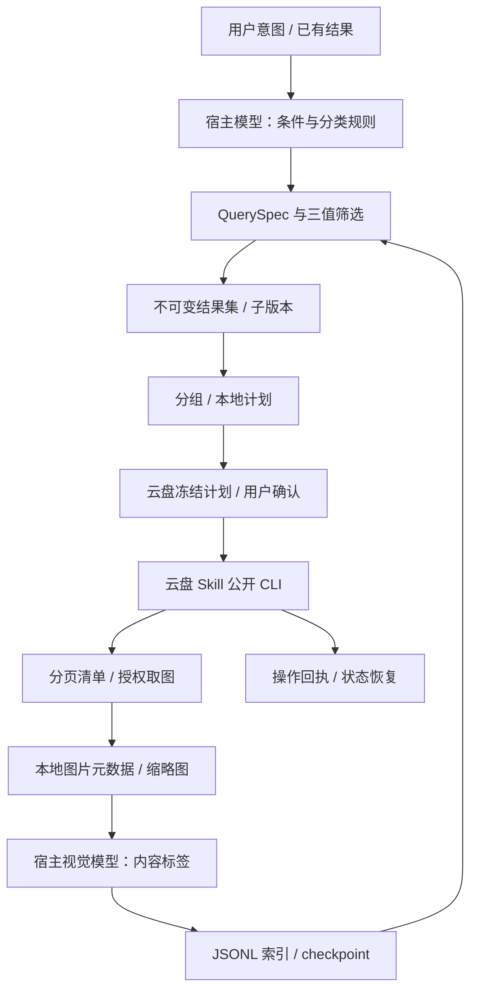

# 功能、代码与 Skill 架构

## 完整工作流



这是两个 Skill 协同：cloud-photo 拥有本地照片流程；cm-cloud-manage 拥有云盘身份、资源引用和业务执行。OpenClaw 提供脚本执行、模型、用户持久存储和媒体通道。无需直连其后端，也不依赖 Nexus 页面。

## 功能落点

| 能力 | 当前实现 | 外部条件 |
| --- | --- | --- |
| 全量/限定范围扫描 | cloud-scan 保存分页进度，--resume 续接 | 云盘搜索及详情权限；游标仍有效 |
| 本地内容索引 | ingest/batch、下载映射、元数据/缩略图、apply/checkpoint | 取图权限、Pillow、宿主视觉模型 |
| 自然语言检索 | 模型产 QuerySpec，代码执行 all/any/not | 词义与同义词由模型解释；不保证未索引内容召回 |
| 结果内二次筛选 | refine/select，保留父子快照和 unknown | 明确父 result ID |
| 自由分组 | 时间、单标签、多标签、最多三维组合、重叠策略 | 使用已有标签；自动分类规则由模型按实际分布选择 |
| 精选 | SHA-256 精确去重；视觉复核后显式 select | 相似/审美/人物不是本地规则引擎自动识别 |
| 云端落地 | 相簿新建/追加、故事、目录复制；orchestrate | 当前账号权限、有效引用、底层确认 |
| 恢复 | 索引批次 checkpoint、扫描游标、结果快照、操作日志 | 跨进程持久目录；未知状态先对账 |

## 代码结构

```text
scripts/
  cloud_photo.py                 主入口，只分发
  index_runner.py                索引命令入口，只分发
  preview_pack.py                静态 contact sheet
  cloud_photo_core/
    cli.py                       参数与路由
    storage.py                   原子持久化、owner 分区、完整性摘要与锁
    manifest.py                  共享 manifest 校验与 JSONL 写入
    indexing.py                  索引 ingest/batch/apply/checkpoint
    assets.py                    规范路径、指纹与保守引用匹配
    media.py                     原图哈希、EXIF、缩略图、视觉任务清单
    query.py                     QuerySpec 校验与三值逻辑
    results.py                   全集、子集、显式选择和引用刷新快照
    grouping.py                  多维分组、精确去重
    plans.py                     冻结成员与分组、数量/长度受限的步骤编译
    execution.py                 prepare/confirm/execute/status 日志
    adapters/cm_cloud.py         公共 CLI subprocess、信封解析、扫描与下载
    legacy.py                    保留旧 manifest/search/plan 命令
```

旧命令保留在 legacy，不作为新架构核心。无需安装三个子 Skill；packages 中的描述文件已移除，避免文档目录被误认为可执行模块。

## 状态结构

```text
<用户工作区>/
  manifest.jsonl
  checkpoint.json
  scan.json                      清单、范围、身份与分页游标
  batches/<batch-id>/             请求、下载映射、标签、报告
  media/                         缩略图与视觉任务
  owners/<owner-hash>/
    results/result-<uuid>.json    完整 items/excluded/unknown 与父引用
    plans/plan-<uuid>.json        不可变分组与结果摘要
    plans/plan-<uuid>.operation.json  原云盘操作和最近回执
```

宿主必须为不同账号/用户分配不同目录。owner 哈希不是权限系统，同一操作系统用户仍可读文件。对话只需携带 result/plan ID，完整成员留在本地。manifest 更新、标签更新与资产删除不静默改写历史结果；重新查索引生成新结果。增量 ingest 不推断未出现成员已删除。

## 恢复和边界

写请求前先落 UNKNOWN 日志；崩溃或超时不会自动重提。准备过的 plan 再次 prepare 返回原日志。SUCCESS 不重放，PARTIAL/FAILED/UNKNOWN 只对账与制定剩余成员的新计划。没有 operationRef 的未知请求需人工核对。引用过期时刷新结果并生成新计划，旧计划不被原地覆盖。

当前执行器没有后台守护进程，也不自动继续 RUNNING 操作；status 可以续查，若服务要求 execute 续执行则交云盘 Skill 按其真实授权契约处理。大编排超出本地参数预算时明确拆分，不能悄悄丢成员。模型标签、人物准确率、实时删除同步、云盘写权限和客户端媒体效果必须分别验收。
