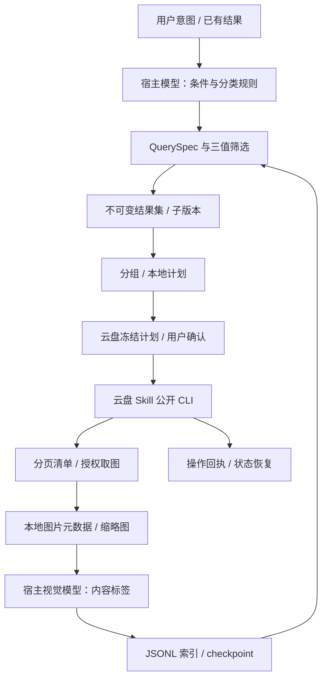

# 功能、代码与 Skill 架构

## 完整工作流



这是两个 Skill 协同：cloud-photo 拥有本地照片流程；cm-cloud-manage 拥有云盘身份、资源引用和业务执行。宿主 Agent 平台提供脚本执行、模型、用户持久存储和媒体通道。无需直连其后端，也不依赖特定前端页面。

## 功能落点

| 能力 | 当前实现 | 外部条件 |
| --- | --- | --- |
| 全量/限定范围扫描 | cloud-scan 保存分页进度，--resume 续接 | 云盘搜索及详情权限；游标仍有效 |
| 本地内容索引 | ingest/batch、下载映射、元数据/缩略图、apply/checkpoint | 取图权限、Pillow、宿主视觉模型 |
| 自然语言检索 | 模型产 QuerySpec，代码执行 all/any/not | 词义与同义词由模型解释；不保证未索引内容召回 |
| 结果内二次筛选 | refine/select，保留父子快照和 unknown | 明确父 result ID |
| 自由分组 | 时间、单标签、多标签、最多三维组合、重叠策略 | 使用已有标签；自动分类规则由模型按实际分布选择 |
| 精选 | SHA-256 精确去重；dHash 相似候选；视觉复核后显式 select | 相似/审美/人物不是本地规则引擎自动识别 |
| 云端落地 | 相簿新建/追加、故事、目录复制；orchestrate | 当前账号权限、有效引用、底层确认 |
| 恢复 | 索引批次 checkpoint、扫描游标、结果快照、操作日志 | 跨进程持久目录；未知状态先对账 |

## 代码结构

```text
scripts/
  cloud_photo.py                 主入口，只分发
  index_runner.py                索引命令入口，只分发
  preview_pack.py                静态 contact sheet
  cloud_photo_core/
    cli.py                       参数与路由
    storage.py                   原子持久化、owner 分区、完整性摘要与锁
    manifest.py                  共享 manifest 校验与 JSONL 写入
    indexing.py                  索引 ingest/batch/apply/checkpoint
    assets.py                    规范路径、指纹与保守引用匹配
    media.py                     原图哈希、EXIF、缩略图、视觉任务清单
    query.py                     QuerySpec 校验与三值逻辑
    results.py                   全集、子集、显式选择和引用刷新快照
    grouping.py                  多维分组、精确去重
    similarity.py                有上限的感知哈希候选与复核快照
    coverage.py                  逐字段覆盖统计，不推断识别准确率
    enrichment.py                候选缺失字段任务与选集证据刷新
    progress.py                  已有操作进度与恢复指引，不自动重放
    diagnostics.py               Python、图片解码器与工作区自检
    plans.py                     冻结成员与分组、数量/长度受限的步骤编译
    execution.py                 prepare/confirm/execute/status 日志
    adapters/cm_cloud.py         公共 CLI subprocess、信封解析、扫描与下载
    adapters/provider_lock.py    按上游包和 profile 跨进程串行化调用
    legacy.py                    保留旧 manifest/search/plan 命令
```

旧命令保留在 legacy，不作为新架构核心。无需安装三个子 Skill；packages 中的描述文件已移除，避免文档目录被误认为可执行模块。

## 状态结构

```text
<用户工作区>/
  manifest.jsonl
  checkpoint.json
  scan.json                      清单、范围、身份与分页游标
  batches/<batch-id>/             请求、下载映射、标签、报告
  media/                         缩略图与视觉任务
  owners/<owner-hash>/
    reviews/review-<uuid>.json    相似候选、边距离与来源结果摘要
    results/result-<uuid>.json    完整 items/excluded/unknown 与父引用
    plans/plan-<uuid>.json        不可变分组与结果摘要
    plans/plan-<uuid>.operation.json  原云盘操作和最近回执
```

宿主必须为不同账号/用户分配不同目录。owner 哈希不是权限系统，同一操作系统用户仍可读文件。对话只需携带 result/plan ID，完整成员留在本地。manifest 更新、标签更新与资产删除不静默改写历史结果；重新查索引生成新结果。增量 ingest 不推断未出现成员已删除。

## 恢复和边界

写请求前先落 UNKNOWN 日志；崩溃或超时不会自动重提。准备过的 plan 再次 prepare 返回原日志。SUCCESS 不重放，PARTIAL/FAILED/UNKNOWN 只对账与制定剩余成员的新计划。没有 operationRef 的未知请求需人工核对。引用过期时刷新结果并生成新计划，旧计划不被原地覆盖。

当前执行器没有后台守护进程，也不自动继续 RUNNING 操作；status 可以续查，若服务要求 execute 续执行则交云盘 Skill 按其真实授权契约处理。大编排超出本地参数预算时明确拆分，不能悄悄丢成员。模型标签、人物准确率、实时删除同步、云盘写权限和客户端媒体效果必须分别验收。

## 三类请求的功能契约

| 入口 | 模型决策 | 确定性处理 | 完成条件 |
| --- | --- | --- | --- |
| 直接搜索并整理 | 明确范围、绝对时间、类型/人物条件、分类维度 | query → group-plan → prepare → execute | 目标成员回读与冻结计划对账 |
| 整理搜索结果 | 解析“这些”对应的 result ID，按用户规则分组 | result-show → group-plan，必要时 select | 整理成员来自指定快照，未默认截取展示页 |
| 搜索结果二次筛选 | 把新增条件转为 QuerySpec，解释未知项 | refine → 新 result ID；精选使用 review/select | 子结果不逃逸父集合，父集合可继续使用 |

自由整理允许按用户条件组合标签、时间及显式选择。模型负责理解“旅行”“一家人”等表达，但必须有实际视觉证据或用户确认的人物映射；没有身份识别服务时，不能承诺跨照片自动认出指定人物。多轮放宽条件需要返回祖先结果或重新查询原范围。

## 四种完整性分别记录

1. **来源完整性**：scan 的 complete 表示指定范围分页取尽；result.coverage.complete 继承查询调用方对范围的声明，不能代替扫描验证。
2. **处理进度**：checkpoint 的 pending/partial/complete/error 表示索引阶段。complete 不表示人物、质量、OCR 等全部字段都识别过。
3. **字段覆盖**：index_runner report 输出各字段 populated/unknown；有值不等于准确，也不等于检索召回率。查询自己的 unknown 必须单独展示。
4. **执行证据**：本地 plan、上游 operation 成功、目标成员回读是三个不同阶段。最终按相簿/故事/目录的公开列表分页回读，对比实际成员；不能只看计划生成成功。

## 模块依赖与扩展方式

cli 只负责参数、调用与输出。results 依赖 query/storage；grouping 与 similarity 处理固定结果；plans 编译分组与公开操作；execution 管理提交和回执；只有 adapters 知道云盘 CLI 的参数与信封。media 只从真实文件提取证据，indexing 合并标签。视觉服务接入应输出既有标签协议，不把模型 SDK、凭据或提示词逻辑塞入查询引擎。

Skill 保持一个入口，按任务加载 references：首次接入读 dependencies/host-integration，建索引读 index-runner/photo-index，检索读 index-guidance，执行读 organizing/evidence-pack。README 面向安装者；SKILL 面向执行 Agent；architecture 解释边界。运行状态和演示数据放用户工作区，不随 Skill 发布。

## 宿主与上游仍需提供的能力

- 宿主：实际可调用的视觉模型、用户持久目录、图片发送、长任务调度和会话恢复。CLI checkpoint 能恢复数据，但不会自行唤醒 Agent。
- 云盘 Skill：授权范围内的取图、稳定可用的业务引用、相簿/故事/目录操作及真实回执。相簿搜索用于查已有相簿，照片内容检索可在建相簿前使用本地索引完成。
- 人物与质量：视觉标签及身份映射需要单独验证；dHash 仅找近似画面候选，不解决人物聚类、裁剪相似、审美排名。
- 整体部署：既要验证三类请求，也要验证未识别、下载拒绝、引用过期、进程中断和部分成功。当前代码没有自动回滚、后台守护进程或专用前端；这些要求由宿主提供或另行实现，不能仅凭两个 Skill 已安装就宣布全部覆盖。
