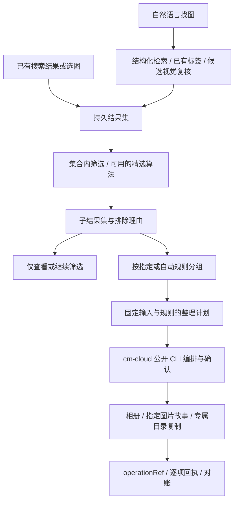

# Mclaw 接入设计：只通过云盘 Skill

目标宿主为支持 Skill 与脚本执行的 OpenClaw 环境。云端访问边界固定为 `@org-vt43r0t0/cm-cloud-manage` 的公开 CLI；本包不直连 Mclaw/OpenClaw 后端。当前核验版本和命令见 [接口清单](cm-cloud-api.md)。本文的数据结构与模块是**待实现契约**，不是现成 CLI 功能。

## 职责划分

| 层次 | 职责 |
| --- | --- |
| Mclaw / OpenClaw 宿主 | 加载两个 Skill、exec 环境、模型图片输入、用户隔离的持久工作区、媒体交付与会话恢复 |
| cloud-photo | 条件归一化、候选范围、标签索引、集合内筛选、分组命名、整理计划、执行映射和结果汇总 |
| cm-cloud-manage | 云盘授权与权限、文件检索/读取、相册与故事原子动作、文件夹复制、计划确认和操作回执 |
| 上游需扩展的公开能力 | 语义搜图、照片语义元数据、人物/精选能力，以及稳定资源键与引用刷新 |

云盘 Skill 自身不接受“自由整理照片”作为一个完整业务场景。cloud-photo 把该意图拆成明确照片集合和受支持的 create/add/mkdir/copy 动作；不通过导入内部 adapter 取得未开放的能力。

## 完整工作流



自然语言理解由模型完成，集合边界、条件计算、分批、引用校验和计数由确定性代码完成。当前没有公开云端语义召回时，只能使用已支持的检索条件和本地已索引内容；缺失内容证据须补充，不能把文件名检索包装成语义检索。

## 1. 云盘 CLI 适配

适配器发现实际安装目录，使用 `scripts/cm_cloud_<domain>_api.py`，通过 argv 调用并消费 JSON 信封。启动时读取版本、capabilities 与相关 schema；缓存能力摘要，不在每张照片上重复发现。云盘 profile 与宿主 owner 的绑定由可信配置提供，用户语句不能改变身份上下文。

只暴露本任务所需的 files/album/operation/control 操作。分页保留原条件与 pageSize，保存每页回执和 `complete`。`page.total=null` 不是不完整的充分条件。返回错误、未知和空结果必须区分。

不得把 `files.info.location` 当地理位置，不得假设 search 返回标签/人物/质量数据，也不得把 schema 可见的 dynamicRefs 分支视为已开放。详细限制见 [接口清单](cm-cloud-api.md)。

## 2. 资产身份与引用恢复

需要分别管理：

- **asset_id**：cloud-photo 的本地稳定身份，用于结果集、分组和报告。
- **fileRef / albumRef / folderRef**：底层短期、绑定 profile 的受控引用，仅用于当前合法调用。
- **来源证据**：账号/来源、规范路径、名称、大小、修改时间，以及已下载内容的哈希（如果有）。

云盘当前不公开稳定原始 fileId；引用默认 12 小时过期且跨调用可能变化。因此跨调用不能直接对 fileRef 求交集、去重或判断“已在相册中”。同一有效快照可沿用其引用，长期恢复需重新绑定并核对身份。

现阶段通过 `files.info` 在引用有效时补齐路径/元数据；过期后重新 list/search 获取候选，对规范路径和来源证据作唯一匹配。路径相同但内容发生变化不能认定为同一资产；同名、多候选、已改名/移动、路径复用须停在 unresolved。不能读云盘内部台账绕过公开边界。

当前 `resolve-refs` 允许路径失配后按唯一文件名回退，**不满足上述执行标准**；只可辅助审阅，待修复后才能驱动自动写入。完整恢复最好由上游公开稳定资源键、批量刷新和失效原因。稳定键可以是不暴露业务 ID 的受控 opaque key。

## 3. 持久结果集

按用户/会话隔离，保存不可变 JSON/JSONL 快照。会话携带句柄与摘要，完整照片清单留在持久工作区。

```json
{
  "schema_version": "cloud-photo/result-set/v1",
  "result_set_id": "rs-example-v2",
  "owner_ref": "host-bound-owner",
  "session_id": "session-example",
  "parent_result_set_id": "rs-example-v1",
  "version": 2,
  "operation": "refine",
  "scope": {"kind": "result_set", "id": "rs-example-v1"},
  "query": {"text": "去年海边旅行", "filters": {"exclude_types": ["screenshot"]}},
  "coverage": {"loaded_count": 120, "reported_total": null, "complete": true},
  "items_ref": "items.jsonl",
  "excluded_ref": "excluded.jsonl",
  "unknown_ref": "unknown.jsonl"
}
```

该示例不是当前脚本输出；实现还需保存绝对时间范围、时区、查询/标签版本、创建时间和引用绑定信息。收窄必须是输入集合子集；放宽早期条件回到覆盖被排除照片的祖先集合。已经保存的快照表示搜索当时的范围，不承诺实时同步云盘变动。

快速模式移交时带完整可解析清单或结果集句柄、条件、用户选中项、来源和原会话。外部搜索的业务 ID 不能直接传入云盘 CLI；必须经公开的身份绑定契约转换，当前缺少该接口时报告移交限制。

## 4. 筛选、精选与分组

QuerySpec 支持 all/any/not、时间范围及字段、地点、人物标识、内容标签、格式、来源；字段缺失为 unknown。云盘当前支持的条件可以下推用于初始召回，其余在固定结果集内按事实标签或视觉复核执行。排除理由属于本次结果，不写入长期标签。

人物“妈妈”需要用户确认的映射或上游选脸/人物簇能力。通用视觉标签不能承诺可靠认人。精确字节去重可在合法下载后计算哈希；相似照片与清晰度精选需要专门算法或明确的视觉复核规则，不用 asset_id 去重代替。全局去重应覆盖全集，不能逐页选完就当全局完成。

GroupPlanner 保存分类维度、维度顺序、命名模板、目标类型、同图多组或互斥策略、未知项归属。自动分类先依据实际标签分布选择规则；用户指定规则优先。计划固定 result_set_id/version、成员清单、目标引用/名称、规则摘要和授权范围。

## 5. 执行与批量边界

| 整理目标 | 公开动作 | 执行要求 |
| --- | --- | --- |
| 新建普通相册 | album.create kind=album + fileRefs | 非空；每次最多 500 图，余量对真实 albumRef 分批 add |
| 追加已有相册 | album.add | 先定位唯一目标，不按名称盲目新建；无 duplicatePolicy |
| 新建回忆故事 | album.create kind=story | 明确标题、封面和 1–500 张选图；无故事追加、排序或自动精选接口 |
| 文件夹归档 | files.mkdir + files.copy | 目标须在专属目录；按层创建/定位目录，复制保留原图 |

多写动作优先交底层 `orchestrate`，用前步产物绑定引用。分批同时满足单命令数量、每步 8192 字符、操作计划有效期和进程参数长度；不能仅按“500 张一批”切分。长任务还需处理预先冻结的引用过期，不承诺无限规模的一次确认。

计划确认必须来自底层支持的真实用户确认事件或其允许的对话确认流程，不能生成 confirmToken。已有授权能覆盖的步骤继续执行；方案范围改变时按实际新计划处理。这里的参数和业务确认约束不要求对只读分析反复询问。

保存每组/每批与 `operationRef` 的映射，按信封 `status` / `nextAction` 恢复。建相册成功、加图失败不能重新建册；已成功项不重放，未知项先核对；普通相册与目录分别用 album.files / files.list 对账。没有公开取消/撤销，不能声称修改对话条件已取消运行中的云端动作。

## 6. 模块与数据布局

以下为建议新增模块，当前尚未落地：

```text
scripts/cloud_photo.py                CLI 参数与路由
scripts/cloud_photo_core/
  adapters/cm_cloud.py               公开 CLI 与信封适配
  assets.py                          资产身份、短期引用和恢复
  query.py                           条件归一化与集合内筛选
  result_sets.py                     结果集、父子版本与覆盖范围
  grouping.py                        分类、命名与重叠策略
  plans.py                           固定计划、摘要与参数分批
  execution.py                       operationRef、回执与对账
.cloud-photo/
  manifest.jsonl                     三类标签索引
  results/<result-set-id>/            快照、排除与未知项
  plans/<plan-id>/                    输入版本、分组与动作
  operations/<operation-ref>.json     公开回执与本地映射
```

既有 `index_runner.py` 继续负责索引批次与 checkpoint，避免重建扫描器。JSON/JSONL 足以作为初始事实存储，不为结果集引入向量库。部署必须验证持久化和 owner 隔离；本地写盘不等于跨实例共享。

## 上游扩展清单

为了支持完整的照片整理流程，建议由**云盘 Skill 提供方**增加以下公开契约，cloud-photo 仍只调用该 Skill：

1. 语义照片检索：自然语言、必要的结构化过滤、游标与覆盖范围。
2. 照片元数据：稳定资源键、时间/时区、地理、标签、人物标识、来源、质量、可读图片引用。
3. 指定集合筛选/精选：接收稳定键集合或结果集，返回保留/排除/未知、重复组和原因；允许只筛选而不建故事。
4. 引用恢复：稳定键换当前 fileRef，按权限校验并返回已删除/失效/变更状态。
5. 规模与恢复：大集合输入、长任务状态、失败项恢复；如需大于 500 图故事，明确对应产品与接口能力。

这些是契约诉求，不是已存在的命令名。服务端集合筛选可减少本地下载，但本地 ResultSetStore 仍要维护对话范围与版本。任务卡、返回原对话和模式路由需宿主配合；仅装 Skill 不会自动出现客户端卡片。
